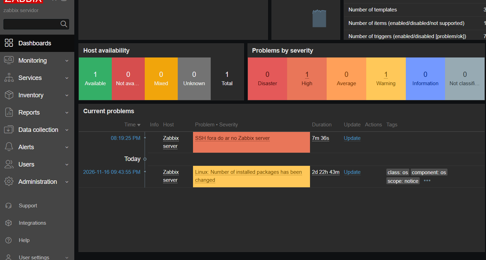
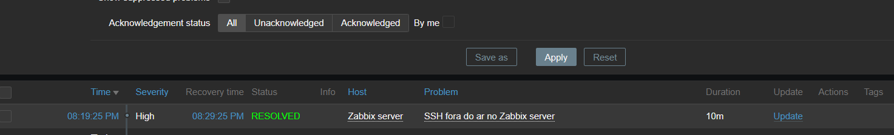

# Laboratório Zabbix — Monitoramento e Alerta de Disponibilidade

## Objetivo
Montar um ambiente de monitoramento do zero e validar o ciclo
completo de um incidente: detecção, alerta e resolução.

## Arquitetura
- **Zabbix Server** (porta 10051) — coleta e avalia os dados
- **Zabbix Agent** (porta 10050) — roda no host monitorado
- **MariaDB** — banco de dados (203 tabelas no Zabbix 7.0)
- **Frontend PHP sobre Apache** — interface web

Ambiente: Ubuntu 24.04 (WSL).

## Instalação
(repositório, pacotes, criação do banco com charset utf8mb4 e
collate utf8mb4_bin, usuário restrito a 'zabbix'@'localhost',
import do schema, configuração do DBPassword, habilitação do
conf do Apache)

## Monitoramento configurado
- **Item:** `net.tcp.service[ssh]` — retorna 1 (disponível) ou 0
- **Trigger:** `last(/Zabbix server/net.tcp.service[ssh])=0`
  severidade High, com a macro `{HOST.NAME}` no nome

## Validação do ciclo
1. Serviço derrubado de propósito
2. Alerta disparou — PROBLEM registrado às 20:19:25
3. Serviço restaurado
4. RESOLVED automático às 20:29:25 — tempo de resolução 10m

## Troubleshooting — problemas reais encontrados

| # | Sintoma | Causa | Correção |
|---|---------|-------|----------|
| 1 | `dpkg: error: cannot access archive ... No such file` | O wget baixou um 404: a URL do repositório não tinha esse caminho | Listei o índice real do repositório e peguei o nome correto do pacote: `zabbix-release_latest_7.0+ubuntu24.04_all.deb` |
| 2 | `W: NO_PUBKEY FC9CA96ACA026560` no apt update | Chave ausente de um repositório de terceiro (HashiCorp), sem relação com o Zabbix. `W:` é aviso, não erro | Desabilitei o repositório renomeando `/etc/apt/sources.list.d/hashicorp.list` para `.disabled` |
| 3 | Pacotes retornando "already the newest version" | O Zabbix já havia sido instalado numa sessão anterior | Diagnostiquei o estado atual em vez de reinstalar |
| 4 | `zabbix-server` subia e morria | O banco de dados `zabbix` nunca tinha sido criado | Criei o banco com `utf8mb4` / `utf8mb4_bin`, usuário `'zabbix'@'localhost'` com privilégio só nesse schema, e importei o schema (203 tabelas) |
| 5 | "O arquivo de configuração está vazio" | Eu tinha aberto `zabbix_sever.conf` — faltava o `r`. O nano cria um buffer novo em silêncio quando o arquivo não existe | Abri o caminho correto, `zabbix_server.conf` |
| 6 | Serviço não conectava no banco, com `DBPassword=` presente | Eu tinha removido o `#` da linha mas não digitado o valor | Preenchi a senha e reiniciei o serviço |
| 7 | HTTP 404 em `/zabbix`, com o conf habilitado e os arquivos presentes | O Apache já estava rodando e lê a configuração só na inicialização | `apache2ctl configtest` e reload. Confirmei com `curl -I` (302 em vez de 404) |
| 8 | Assistente de instalação bloqueado na tela de pré-requisitos | `System locale: C` — o único *Fail* da lista, no fim de uma lista rolável cujas primeiras linhas estavam verdes | `locale-gen en_US.UTF-8 pt_BR.UTF-8` e **restart** do Apache (mudança de ambiente não se resolve com reload) |
| 9 | `Cannot add trigger: incorrect expression` | Duas expressões ficaram concatenadas no campo | O botão "Add" ao lado do campo Expression insere condição no construtor; o que grava o gatilho é o "Add" do rodapé da janela |

## O que eu aprendi

- **`active` e `enabled` são fatos independentes.** Um serviço pode estar rodando agora e não subir no boot — e o contrário também.
- **Serviço lê a configuração na inicialização, para dentro da memória.** Por isso o reload existe: é barato e protege contra configuração quebrada no meio da edição.
- **Mensagem de erro aponta o sintoma, não a causa.** Em cinco dos nove problemas acima, a mensagem apontava para um lugar e o problema estava em outro.
- **Quem escuta numa porta nem sempre é quem se espera.** O `ss -tulpn` responde isso, e `0.0.0.0` é diferente de `127.0.0.1`.
- **Página de erro no navegador não prova que o servidor respondeu.** Cache engana; o `curl -I` não.
- **Triagem é separar ruído esperado de ocorrência real.** O alerta de "número de pacotes instalados mudou" estava correto e era irrelevante — fui eu que instalei os pacotes. O do SSH era o que importava.

## Próximos passos

- [ ] Ação de notificação por e-mail no disparo do gatilho
- [ ] Segundo host monitorado, para exercitar as macros
- [ ] Runbook para um segundo tipo de alerta
